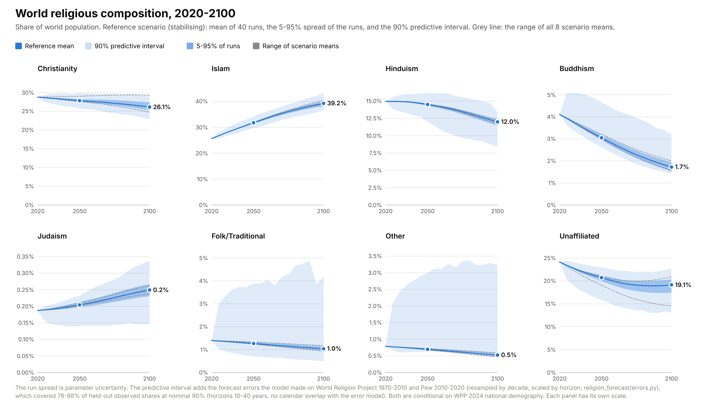
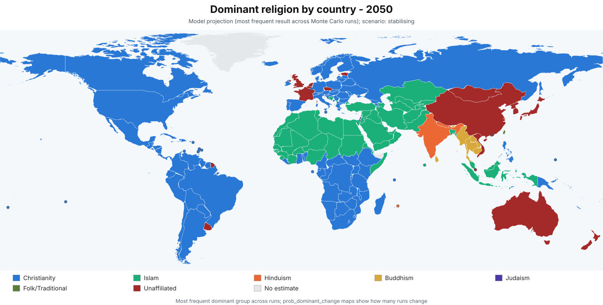
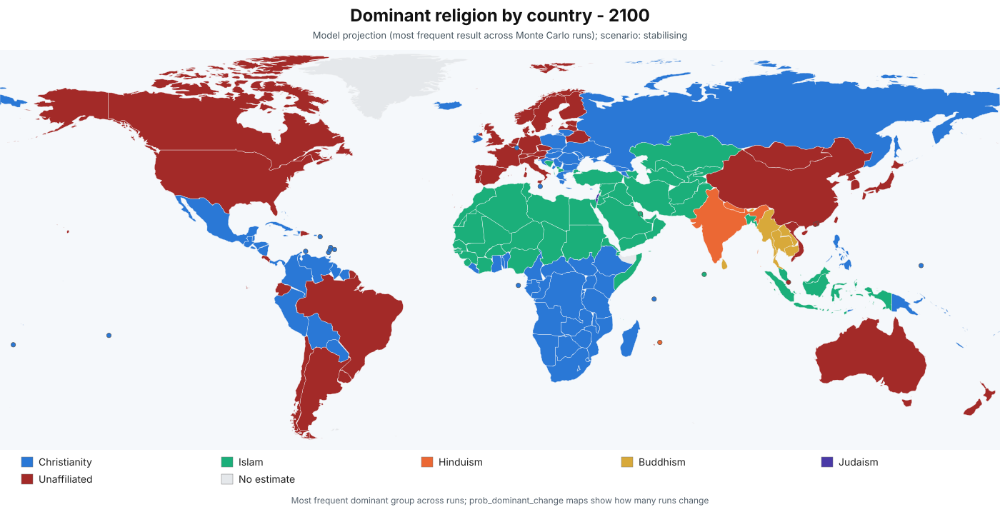
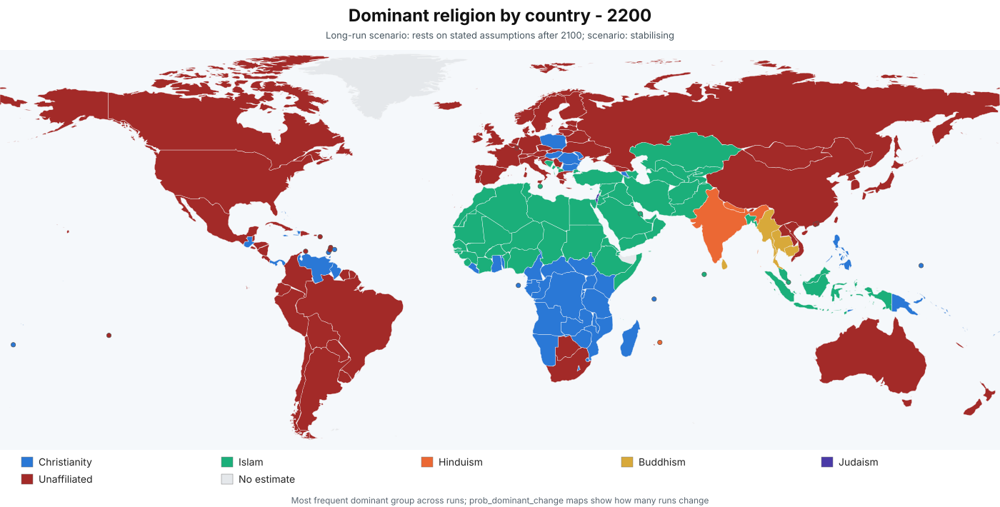
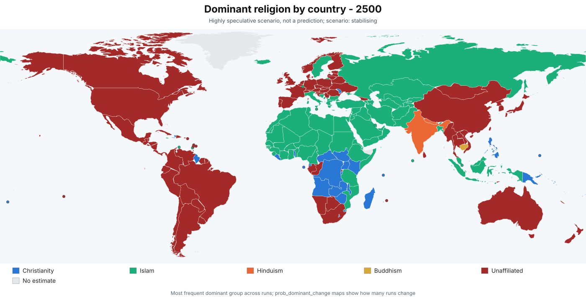
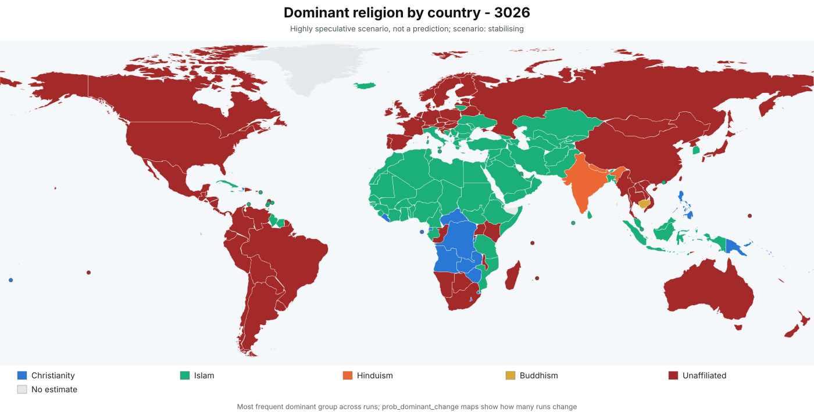

# Projecting the religious composition of countries

[](https://github.com/FLICK11-hash/religion_world_map_predictor/actions/workflows/tests.yml)

**A probabilistic cohort-component model of every country's religions to 2100, and an honest test
of how well it can forecast.** Applied statistics and statistical demography (arXiv `stat.AP`).



The model follows the population of 200 countries by religion (8 groups), migrant generation and
age, and moves it forward in five-year steps through births, deaths, religious switching and
migration. Every change in a country's religious make-up is attributed exactly to the mechanism
that caused it. The model is tested on the decades 1970-2010 with everything fitted only on earlier
data, and its uncertainty intervals are built from the errors it made there.

**New here?** Read [`PROJECT_OVERVIEW.md`](PROJECT_OVERVIEW.md) first, a short overview for
collaborators, and [`CONTRIBUTING.md`](CONTRIBUTING.md) for how to set up and make changes. The paper draft is [`manuscript/manuscript.md`](manuscript/manuscript.md), and the
team's files are in the
[shared Google Drive folder](https://drive.google.com/drive/folders/1sqJtRGLf7Vcu7QMQzK11AN-7bmgUzlXe?usp=drive_link).

## Main findings

- **Nothing beats "no change" over a decade.** Over 558 country-decades, births and deaths alone
  are at most about 2% more accurate than assuming nothing changes. Switching fitted to past change
  makes forecasts slightly worse, and repeating the last decade's change is clearly worse.
- **The model's own uncertainty is far too narrow, but honest intervals can be built.** Its Monte
  Carlo bands contain the truth about a quarter of the time at nominal 90%. Intervals built from
  its past errors contain 86-88% of held-out observations at 10 to 30 years.
- **Islam becomes the world's largest religion by 2100.** Its share rises from 25.6% to 39.1% (90%
  interval 36.7-42.4%) while Christianity's falls from 28.8% to 25.7% (22.6-28.8%). About three
  quarters of Islam's rise is the faster population growth of Muslim-majority countries.
- **Within countries, religious switching drives the change.** In 26 countries the largest religion
  is more likely than not to change by 2100, almost all to no religion: France 89%, United Kingdom
  85%, Germany 78%, United States 42%.

These are projections under stated assumptions, conditional on the UN's population projections.
The maps for 2200, 2500 and 3026 are exploratory. [`docs/RESULTS.md`](docs/RESULTS.md) has the
tables and [`docs/LIMITATIONS.md`](docs/LIMITATIONS.md) what they do and do not support.

## The projected maps

Each map shows the largest religion in every country in one year, under the reference scenario
(`stabilising`). The colour is the most frequent result across the 40 Monte Carlo runs, so it
reflects parameter uncertainty only; how likely a change really is, once the model's past forecast
errors are included, is in [`results/figures/prob_dominant_change_2100.svg`](results/figures/prob_dominant_change_2100.svg)
and `results/projection/dominant_change.csv`. Grey means no estimate.

World shares in the same scenario (percent of world population; 2050 and 2100 with their 90%
predictive intervals in [`docs/RESULTS.md`](docs/RESULTS.md)):

| Religion | 2020 | 2050 | 2100 | 2200 | 2500 | 3026 |
|---|---|---|---|---|---|---|
| Islam | 25.6 | 31.7 | 39.1 | 43.5 | 43.8 | 42.2 |
| Christianity | 28.8 | 27.8 | 25.7 | 21.9 | 19.7 | 18.0 |
| Unaffiliated | 24.2 | 20.7 | 19.5 | 23.7 | 29.3 | 33.8 |
| Hinduism | 14.9 | 14.5 | 12.0 | 8.6 | 5.2 | 3.9 |
| Buddhism | 4.1 | 3.0 | 1.7 | 0.8 | 0.4 | 0.3 |
| Folk/Traditional | 1.4 | 1.3 | 1.1 | 0.9 | 0.9 | 1.1 |
| Other | 0.8 | 0.7 | 0.5 | 0.4 | 0.3 | 0.4 |
| Judaism | 0.2 | 0.2 | 0.3 | 0.3 | 0.3 | 0.4 |

Number of countries (of 200) in which each religion is the largest:

| Largest religion | 2020 | 2050 | 2100 | 2200 | 2500 | 3026 |
|---|---|---|---|---|---|---|
| Christianity | 122 | 118 | 94 | 50 | 28 | 16 |
| Islam | 54 | 54 | 56 | 62 | 76 | 95 |
| Unaffiliated | 11 | 17 | 40 | 81 | 93 | 87 |
| Buddhism | 8 | 6 | 6 | 3 | 1 | 0 |
| Hinduism | 3 | 3 | 3 | 3 | 2 | 2 |
| Judaism | 1 | 1 | 1 | 1 | 0 | 0 |
| Folk/Traditional | 1 | 1 | 0 | 0 | 0 | 0 |

### 2050



Thirty years out, the map is almost the one of 2020: the largest religion changes in only 6
countries. In the United Kingdom, France, Australia and Belgium people with no religion overtake
Christians, and in Singapore and Mongolia they overtake Buddhists. The world already looks different
in its totals: the Muslim share rises from 25.6% to 31.7%, four fifths of it because the populations
of Muslim-majority countries grow faster.

### 2100



By 2100 the largest religion has changed in 31 countries, 26 of them from Christianity to no
religion, among them Russia, Germany, the United Kingdom, France, Italy, Spain, Argentina, Canada,
Australia and Chile, and Taiwan joins them from folk religion. North Macedonia and Cyprus change from
Christianity to Islam. Islam becomes the largest religion in the world (39.1%, 90% interval
36.7-42.4%), ahead of Christianity (25.7%, 22.6-28.8%). Once past forecast errors are included, 26
countries have a better-than-even chance of changing (France 89%, United Kingdom 85%, Germany 78%,
United States 42%). This is the last year with predictive intervals: beyond 2100 there are no UN
population projections and every input becomes a stated assumption.

### 2200 (exploratory)



If switching continues at the assumed pace and slows only gradually, people with no religion become
the largest group in much of the Americas and Europe, including the United States, Brazil and
Mexico, and the unaffiliated lead in 81 countries against 50 for Christianity. Islam becomes the
largest religion in 62 countries, adding Ethiopia, Benin, Sweden, Malta and Montenegro. Islam
reaches 43.5% of the world.

### 2500 (exploratory)



The map now reflects the long-run assumptions more than any current trend: fertility converging
across countries, switching fading towards a floor, and migration continuing at 2100 rates. Islam
is the largest religion in 76 countries, including Russia, Italy, Greece and much of East Africa
(Ethiopia, Tanzania, Mozambique); the unaffiliated lead in 93. Christianity remains the largest in
28 countries, mostly in central and southern Africa and the Pacific.

### 3026 (exploratory)



A thousand years from today, under the same assumptions, the world divides between two groups:
Islam is the largest religion in 95 countries and the unaffiliated in 87, with 42% and 34% of the
world's population. Christianity remains the largest in 16 countries, among them the Philippines,
Kenya, Angola, Zambia and Zimbabwe, and Hinduism in India and Nepal. This map shows what a fixed
set of long-run assumptions implies after a millennium, not what will happen: the eight scenarios
disagree by up to 64 percentage points on the world Muslim and unaffiliated shares by then
([`results/figures/world_composition_long_run.svg`](results/figures/world_composition_long_run.svg)).

## See the results without running anything

| | |
|---|---|
| [`results/comparison_report.md`](results/comparison_report.md) | the run report, every table in one page |
| [`results/figures/`](results/figures) | every map and chart; download it and open `index.html` to hover over countries |
| [`results/projection/`](results/projection) | world and country shares by year and scenario, with intervals |
| [`results/validation/`](results/validation) | history tests, interval calibration and the estimator check |
| [`results/experiments/`](results/experiments) | what each mechanism contributes, and which assumptions matter |

## Run it

```bash
python -m venv .venv && . .venv/bin/activate      # Windows: .\.venv\Scripts\activate
pip install -r requirements-lock.txt               # the exact versions the results were made with
pip install -e '.[prepare]'
python scripts/prepare_raw_data.py                 # downloads the three core datasets
python run.py fetch                                # the optional datasets
python run.py test                                 # 28 tests, under a minute
python run.py all --quick                          # the whole pipeline in about 15 minutes; results/ untouched
python run.py all                                  # the full run, about 35 minutes on 4 cores; rewrites results/
```

Pew's country data for 2010 and 2020 (the Global Religious Futures dataset, free Pew account) is not
in the committed run. With it in `data/raw/`, run `python scripts/prepare_pew_panel.py` before
`python run.py all`; this adds the 2010-2020 test decade. `python scripts/benchmark_pew2026.py` then
compares the run with Pew's own 2026 projections. Every stage, the
code layout and the reproducibility checklist are in
[`docs/REPRODUCIBILITY.md`](docs/REPRODUCIBILITY.md); every dataset is described in
[`docs/DATA.md`](docs/DATA.md).

## Repository

| Folder | Contents |
|---|---|
| `religion_forecast/` | the model and its evaluation (Python package) |
| `results/` | one complete committed run: report, figures and tables |
| `manuscript/` | the paper draft and its figures, including PNG versions of every map above |
| `docs/` | methods, results, limitations, data, reproducibility |
| `config/`, `inputs/` | every assumption, and the published figures the model uses, with sources ([`inputs/README.md`](inputs/README.md)) |
| `scripts/`, `tests/` | data preparation and the test suite |
| `previous_grad_assignment/` | the two simpler programs from the course exercise the project began as |

## About

The project began in October 2026 as a graduate course exercise and has since been developed as a
research project. Earlier versions of the model remain in the git history (tags
`archive/pre-merge-main` and `archive/pre-merge-research`). Most of the code and documentation was
written with an AI coding assistant under the author's direction; every
reported number is regenerated by the code from documented inputs.

Citation metadata is in [`CITATION.cff`](CITATION.cff). There is no licence file yet, so the code is
under default copyright; each dataset keeps its own terms (`config/data_manifest.json`).
