# How predictable is religious composition? A probabilistic cohort-component projection for 200 countries and its out-of-sample evaluation

Conrad Flick, Jingyu Huang and Taleh Malikov

University of Chicago, Chicago, IL, United States

Corresponding author: Conrad Flick, ORCID 0009-0001-9508-9444.

*Revised draft (revision 11), 24 November 2026, prepared for submission to Demographic Research as a Research Article. Every number comes from the committed run in the project repository (github.com/FLICK11-hash/religion_world_map_predictor). Items in \[square brackets\] must be completed before submission.*

## Abstract

**Background:** Projections of the world's religious composition are widely cited, but their accuracy has not been systematically tested and their uncertainty is not calibrated on past errors.

**Objective:** We ask whether a mechanistic projection beats assuming no change, whether calibrated predictive intervals can be built, and which mechanisms drive change to 2100.

**Methods:** A probabilistic cohort-component model follows 200 countries by religion, migrant generation and age through fertility, mortality, switching and migration. Switching is estimated by empirical Bayes from survey and historical evidence. It is evaluated on 1970–2020 with parameters fitted only to earlier data; predictive intervals are built from its past errors.

**Results:** Over 758 country-decades no version of the model is distinguishable from persistence. Its Monte Carlo bands cover the observed share a quarter of the time at nominal 90%; intervals built from its past errors cover 85–88% at horizons of 10–30 years. The world Muslim share rises from 25.6% in 2020 to 39.2% in 2100 (90% interval 36.6–43.2%), overtaking Christianity around 2035; the Christian share falls to 26.1% (22.8–29.3%). Three quarters of Islam's rise reflects faster population growth in Muslim-majority countries. Within countries switching dominates: in 32 countries the largest religion is more likely than not to change by 2100.

**Conclusions:** Religious composition is close to unpredictable at decadal horizons. Over the century, Islam's lead rests on population growth and survives without switching; how far Christianity falls depends on switching.

**Contribution:** We provide, to our knowledge, the first systematic out-of-sample evaluation of religious projections and calibrated predictive intervals for them, with open code.

**Keywords:** religion, religious switching, cohort-component projection, probabilistic projection, forecast evaluation, predictive intervals, international migration, secularization

## 1 Introduction

The religious map of the world looks permanent, but history suggests otherwise. Within about a century of its founding, Islam had spread from the Arabian Peninsula across the Middle East and North Africa. Christianity became the majority religion of the Americas within a few generations of European colonization, and in the twentieth century communist states promoted irreligion so effectively that large shares of their populations came to report no religious affiliation. If religious composition has changed this quickly in the past, how well can its future be projected?

The best-known projections of the world's religions answer a different question. Pew Research Center (2015) and Hackett et al. (2015) applied multistate cohort-component methods to eight religious groups in every country from 2010 to 2050: fertility, mortality, religious switching and migration were applied to each group's population by age and sex under one set of assumptions. The result is a single path. It has no uncertainty interval, and the method has not been tested against what such a projection would have predicted for decades that have already happened. Probabilistic population projections, which do both, are now standard for national populations (Raftery et al. 2012), and the accuracy of past United Nations projections has been studied in detail (Keilman 1998, 2001), but neither practice has been applied to religious composition. Hackett et al. (2026) have just updated these projections to 2070 from a revised 2020 base. They hold recently observed switching, fertility differences and migration constant, explore what-if scenarios without each, and compare their 2015 projections informally with the change observed in 2010–2020, finding the direction and scale right for most groups but the growth of the unaffiliated underestimated. They report no probabilistic intervals and no systematic test against simple baselines.

This paper builds a probabilistic cohort-component projection of religious composition for 200 countries and asks three questions of it. First, does a mechanistic projection forecast past decades better than assuming no change, once every parameter is fitted only to data available at the forecast origin? Second, how large is its forecast error, how does that error grow with horizon, and can it be turned into predictive intervals that hold up out of sample? Third, conditional on stated assumptions, which mechanisms account for the projected change to 2100, and how much of that change happens within countries rather than through differences in population growth between them?

The answers are partly negative and, we argue, informative for that reason. At decadal horizons the projection cannot be distinguished from persistence, and switching fitted to historical change does not improve it. The uncertainty the model reports from its own parameters is several times too narrow, but an empirical model of its past forecast errors gives predictive intervals within a few points of nominal coverage up to 30 years, provided the validation keeps every decade a forecast is scored on out of the error model. With those intervals the projection to 2100 still separates the largest groups: Islam becomes the largest religion, mostly because Muslim-majority countries grow faster, while switching turns the unaffiliated into the largest group in a growing number of countries.

The paper makes four contributions. It provides, to our knowledge, the first systematic out-of-sample evaluation of a projection of religious composition, over 758 country-decades in five decades and against simple baselines. It builds predictive intervals from the projection's own past errors and validates them in calendar time, extending the error-based tradition of Stoto (1983) and Keilman, Pham, and Hetland (2002) from population totals to compositions. It decomposes projected change exactly by mechanism and into change within and between countries. And it releases the code and transcribed inputs, which reproduce every number reported. Along the way it documents several estimation errors that are easy to make in this setting and that changed substantive conclusions before they were caught, and it checks the switching estimator by simulation under the real data design. Section 2 reviews the literature, Section 3 describes the data, Section 4 the model and the evaluation design, and Section 5 the results; Sections 6 to 8 discuss them, their limitations and their implications.

## 2 Background

### 2.1 Projecting religious composition

Religious groups differ in fertility, age structure and geographic distribution, so their shares change even when no one changes religion. Cohort-component projections make these differences explicit. Skirbekk, Kaufmann, and Goujon (2010) projected eleven ethnoreligious groups in the United States to 2043 with fertility, migration, religious transmission and switching, and Kaufmann, Goujon, and Skirbekk (2012) used survey data for ten European countries to argue that low secular fertility and religious immigration could slow or reverse secularization in Western Europe. At the global scale, Hackett et al. (2015) and Pew Research Center (2015) projected that the religiously unaffiliated share of the world would fall, from about 16% in 2010 to 13% in 2050, because the unaffiliated have low fertility and are concentrated in aging East Asian populations. These studies established the demographic counterweights to secularization. They report single scenarios or a few variants, without probability statements, and without tests against past change.

### 2.2 Religious switching

Switching is the mechanism by which a country's composition changes without births, deaths or migration, and it is the hardest to measure. Surveys report lifetime switching, the share of adults raised in one religion who now identify with another; this is not an annual rate, and treating it as one inflates projected change. Cross-national survey coverage is uneven, and in Europe and the United States the decline of affiliation proceeds mainly by generational replacement (Voas and Chaves 2016). A projection therefore needs both a careful conversion from lifetime to age-specific rates and a way to borrow strength across countries where surveys are missing.

### 2.3 Probabilistic projection and forecast evaluation

Raftery et al. (2012) replaced the United Nations' deterministic high and low variants with Bayesian hierarchical models for fertility and life expectancy, combined with a cohort-component projection, and showed by fitting on 1950–1990 and predicting 1990–2010 that the resulting intervals were reasonably well calibrated. A complementary tradition evaluates projections ex post: Keilman (1998, 2001) compared successive United Nations projections with later estimates. For religious composition no comparable evaluation exists, partly because consistent historical data are scarce. The World Religion Project (Maoz and Henderson 2013) provides national estimates from 1945, which makes such a test possible. Proper scoring rules for interval forecasts (Gneiting and Raftery 2007) provide the criterion.

Where a projection has a track record, its own past errors give a direct measure of its uncertainty. Stoto (1983) used the errors of past national projections to construct confidence intervals for future ones; Smith and Sincich (1988) found the distribution of errors in projections of state populations stable enough over time for past errors to predict future ones; and Keilman, Pham, and Hetland (2002) used the errors of past official forecasts as one of three routes to a probabilistic forecast for Norway. Alho and Spencer (2005) set out the statistical framework. These studies concern population totals. Applying the idea to religious composition requires an error model for shares bounded by zero and one, and a resampling scheme that keeps together the errors of different groups in one country and of different countries in one decade.

## 3 Data

Table 1 lists the sources. The eight groups are Christianity, Islam, Hinduism, Buddhism, Judaism, folk or traditional religions, other religions, and the religiously unaffiliated. Pew reports folk religions inside "other religions"; they are separated using each country's ratio in the World Religion Project, and the split is labeled as a proxy throughout. The World Religion Project combines estimates from many sources of differing quality and method (Maoz and Henderson 2013), so part of its change from one round to the next reflects measurement rather than behavior. This matters for the evaluation, since no projection can forecast differences in measurement.

**Table 1:** Data sources

| Component                                                                 | Source                                                                                                                        | Coverage and use                                                                                        |
|---------------------------------------------------------------------------|-------------------------------------------------------------------------------------------------------------------------------|---------------------------------------------------------------------------------------------------------|
| Religious composition, 2020                                               | Hackett et al. (2025)                                                                                                         | 200 countries; start of the projection                                                                  |
| Religious composition, 2010                                               | Country dataset of Hackett et al. (2026)                                                                                      | 200 countries; the test decade 2010–2020 and evidence on switching                                      |
| Religious composition, history                                            | World Religion Project, national file (Maoz and Henderson 2013)                                                               | Every five years, 1945–2010; evaluation and evidence on switching; 117 to 164 countries per test decade |
| Population, fertility, mortality, mean age at childbearing, net migration | United Nations (2024a), World Population Prospects 2024                                                                       | Estimates 1950–2023, medium variant to 2100, population by age and sex                                  |
| Bilateral migrant stocks                                                  | United Nations (2024b), International Migrant Stock 2024                                                                      | 1990–2024; the migrant network and its evaluation                                                       |
| Lifetime religious switching                                              | 67 survey cells from 48 survey rows in 33 countries; Hackett et al. (2025) figures for adults aged 18–54 in 117 countries     | Evidence on switching; the "survey level" of switching                                                  |
| Fertility by religion                                                     | National sources for India, Israel, Nigeria and the United States; regional and world figures from Pew Research Center (2015) | Ratios of group fertility to the same source's national fertility                                       |
| Religion of migrants                                                      | 19 published figures, Pew Research Center (2024)                                                                              | Calibrates who migrates where by religion                                                               |

The religion-specific inputs were transcribed by hand with their sources and an evidence grade for each row. The reported run starts from Pew's 2020 composition, which is identical, country by country, to the 2020 estimates in the country dataset released with Hackett et al. (2026). That dataset's 2010 estimates add a fifth test decade, 2010–2020, measured for all 200 countries by the source the projection starts from.

## 4 Methods

### 4.1 State and projection step

The state is the number of persons in country c (200 countries), religion r (8 groups), migrant generation g (native-born; foreign-born; native-born children of foreign-born mothers) and five-year age group a (17 groups, the last open at 80 and over). The population moves forward in five-year steps from 2020. Each step applies, in order: survival, births, a rescaling of each country's natural growth to the United Nations' projection (to 2100), religious switching, emigration and immigration. The change in every country's religious shares is recorded at each sub-step, so the decomposition of change by mechanism adds up exactly to the simulated change. Appendix Table A1 lists the notation.

Survival follows life tables from a Siler-type hazard fitted to each country's life expectancy at birth and under-five mortality, and the open age group is projected as N80+(t+5) = (5L80 / 5L75) N75–79(t) + (T85 / T80) N80+(t). Mortality does not differ by religion. Births to women of religion r and generation g are

Bcrg = TFRc · kc · relcrg · Σa fc(a) Wcrga,     (1)

where W is woman-years (the persons in each reproductive age group times the United Nations' female share of that age group, so that the model needs no separate sex dimension), fc a fertility schedule matching the country's mean age at childbearing, and kc normalizes so that the country total reproduces the United Nations' fertility exactly. The relative fertility rel comes from the most local published figure: country ratios are used as published, regional ratios are damped by a factor drawn from 0.6–1.0, and world ratios by a factor drawn from 0.3–0.7, because a ratio measured across countries mostly reflects where each group lives. Gaps converge to zero with a half-life of 30–80 years. Children take their mother's religion.

### 4.2 Religious switching

Each country's lifetime switching is described by three probabilities: disaffiliation dr (raised in r, now unaffiliated), conversion vr (raised in r, now another religion, with destinations in proportion to local prevalence) and affiliation a (raised unaffiliated, now religious). The lifetime matrix is spread over ages 15–49 by solving for five-year age-specific matrices whose product reproduces it. Switching among foreign-born residents and their children is scaled relative to natives (0.3–0.6 and 0.4–0.8).

The rates follow a hierarchical model on the logit scale,

logit dcr = μd,r + δ + βd zc + τu ξc + τe ξcr, logit ac = μa + βa zc + τa ξ′c, logit vcr = μv,r + τv ξ″c,     (2)

where zc is a development index (standardized life expectancy and negative log fertility), the μ are prior centers ordered as in Hackett et al. (2025), and the ten country effects ξ (one common to all religions, ξc; one for each of the seven religions that can be left for no religion, ξcr; and one each for affiliation and conversion) are standard normal. The hyperparameters H = (δ, βd, τu) are estimated by maximizing the marginal likelihood of two kinds of evidence. The first is net change: a hindcast of each historical decade (six World Religion Project decades from 1950 and Pew's decade 2010–2020) with births, deaths, aging and migration but no switching leaves a residual in every country's shares, linked to the rates through the first-order effect of switching on the population exposed at switching ages; its likelihood is Student-t with four degrees of freedom, and each decade is down-weighted by one half because decades of one source are not independent. The second is the survey evidence: each survey row, the adults of one country raised in one religion, is one Dirichlet-multinomial observation of the cells it reports, with a complement cell for the rest and concentration α = 100.

The country integrals are estimated by importance sampling with 512 draws per country from a defensive mixture (Hesterberg 1995): the prior, a multivariate t at each country's posterior mode with the inverse curvature as scale, and a t matched to the weighted moments of a pilot sample. The marginal likelihood is maximized by Nelder-Mead from several starting points, with the proposal re-centered on the optimum until it stops moving, and three independent replicate fits are used. The curvature of the marginal likelihood gives a Laplace approximation to the posterior of H under a flat hyperprior on its prior range; each projection run draws its own H from it and each country's effects from their posterior at that H (Kass and Steffey 1989). Pew's 2025 figures for adults aged 18–54 define a second "survey level" of switching through a logit shift per religion (higher than the history-fitted level for Christians and Buddhists, lower for Muslims and Hindus; Table 3), and each run draws a weight between the history-fitted and the survey level.

### 4.3 Migration

Migration is a gross origin-destination flow matrix per step. To 2100 the flows target each country's net migration in the United Nations' projection, with two-way circulation added, and are fitted by Sinkhorn scaling to a kernel that mixes the observed migrant network with a gravity term in distance, shared borders and continent. Because projected net migration sometimes conflicts with the network (for example, sustained emigration from Pakistan while Gulf immigration falls to almost zero after 2030), the margins are allowed to give way, which moves flows between corridors without changing the world volume of migration; on average a run's net migration departs from the United Nations' by 27% of the world's total absolute net migration. Who moves is drawn in proportion to age, generation and a corridor-specific religious mix: migrants favor destinations where their religion is common, and minorities emigrate more, with a religion's emigration rate per person bounded at three to six times its origin's average. The two parameters of this mix are fitted to the 19 published figures on the religion of migrants. Migrants keep their religion, so migration conserves every religion's world total exactly.

### 4.4 After 2100, uncertainty and scenarios

Beyond 2100 every input is an assumption: national fertility converges to a long-run level of 1.6–2.1 with a half-life of 50–150 years, country deviations decay with a half-life of 100–400 years, life expectancy rises by 0.02–0.06 years a year to a cap of 90–95, migration continues at 2100 rates, and in the reference scenario switching fades towards a floor. Each scenario is run 40 times, each run drawing every uncertain parameter from its range (Appendix Table A2), so the spread of the runs measures parameter uncertainty. With 40 runs the Monte Carlo standard error of a world share in 2100 is at most 0.14 percentage points (0.09 for Islam), small beside every interval reported. Eight scenarios vary the pace of secularization, the level and pattern of migration and the persistence of fertility gaps (Appendix Table A3). Run r uses the same random draws in every scenario.

### 4.5 Evaluation design

Each World Religion Project decade from 1970–1980 to 2000–2010, and Pew's decade 2010–2020, is forecast from its first year, with switching fitted only on decades that ended by then. National demography inside each decade is the United Nations' estimate, so every model is scored conditional on national fertility, mortality and net migration. The score is the population-weighted total-variation distance between forecast shares ŝck and observed shares sck,

TV = Σc wc · ½ Σk \|ŝck − sck\|,     (3)

where wc is country c's share of the population of the countries scored; TV is reported in percentage points. The baselines are persistence, a naive trend (the previous decade's observed change repeated) and a hybrid (the demographic forecast plus the previous decade's unexplained change). With five decades an exact decade-level sign-flip test cannot fall below p = 0.0625, so each model is also compared with persistence country by country, with a 95% interval from 4,000 bootstrap resamples of countries.

From each origin 1970, 1980, 1990 and 2000 the model is run forward 40 times and scored at every later World Religion Project decade to 2010, and from 2010 it is scored against Pew's 2020 estimates, giving 758 country forecasts at a horizon of 10 years, 391 at 20, 253 at 30 and 117 at 40. With s the mean forecast share and h the horizon, the error is modeled as

e = (h/10)β · (s(1 − s) + 10−4)b · u,     (4)

with b estimated over shares observed above zero and β from the growth of the mean absolute standardized error with horizon. A predictive draw adds to each model run an error resampled in two stages: one historical decade for the whole world, which keeps the common shock that matters for world totals, then for each country the error vector of one of its 15 nearest neighbors in composition in that decade (Lall and Sharma 1996). The intervals are validated out of sample in calendar time: for each forecast, the error model is refitted on the record entries whose periods do not overlap its own, and the forecast is scored by coverage and by the interval score of Gneiting and Raftery (2007) for an interval (l, u) and an observation x,

ISα(l, u; x) = (u − l) + (2/α)(l − x)+ + (2/α)(x − u)+,     (5)

which rewards narrow intervals and penalizes observations that fall outside them. Coverage is reported for shares observed above zero, because a group recorded at exactly zero falls inside any interval reaching zero. When the held-out entries all have a horizon of 10 years, β cannot be estimated and is set to that of a random walk (β = 0.5); for the single 40-year forecast, 1970–2010, the only such entry is Pew's decade 2010–2020, so calibration at 40 years rests on one decade of held-out errors. Finally, the switching estimator is checked by simulation: twenty times, evidence is generated from the fitted hyperparameters with the real design (the same countries, decades, survey rows and sample sizes) and the model is refitted.

## 5 Results

### 5.1 Forecasting past decades

Table 2 gives the error of ten-year forecasts of the four World Religion Project decades 1970–2010 and of Pew's decade 2010–2020. Over all five decades persistence errs by 4.21 percentage points of total-variation distance (4.41 in the World Religion Project decades, 3.44 in Pew's). Births and deaths alone err by 4.19 and adding migration by 4.18; adding switching at the projection's strength raises the error to 4.58. Country by country, births and deaths differ from persistence by −0.02 points (95% interval −0.06 to +0.06), so they are at most about 2% better. Only the two trend baselines are distinguishable from persistence, and both are worse. The decade-level sign-flip test agrees: the trend baselines are worse in all five decades (p = 0.0625, the smallest value five decades allow), and no mechanistic variant comes close (p ≥ 0.56). Because countries in one decade share common shocks, the country bootstrap understates uncertainty, so the conclusion that no mechanistic variant is distinguishable from persistence holds a fortiori.

Pew's decade is the test closest to the projection itself: it is measured, for all 200 countries, by the source the projection starts from. There switching at full strength is the best variant, 7% better than persistence, but the gain is not distinguishable from zero (−0.24 points, 95% interval −0.70 to +0.16), and in the World Religion Project decades the same variant is 12% worse.

Fitted to net change alone, the switching model puts the country spread τu at the upper bound of its prior range in each of the four World Religion Project folds (and at 1.67 of a maximum of 2 for the Pew decade) and reproduces country trends in earlier decades that do not continue, which is the failure of the trend baselines in another form. Choosing the strength of switching on earlier decades does not rescue it: the strength chosen falls from 1 for 1970–1980 to 0.5 for 1980–1990 and to 0 for the three later decades, Pew's included, so by the end of the record the historical evidence prefers no switching at all. Richer demographic inputs do not help either: adding the United Nations' age structure by sex, the bilateral migrant stocks and the calibrated religion of migrants changes the error of the demographic forecasts by at most 0.04 points, and every variant stays within 0.05 points of persistence in both sources (Appendix Table A4).

**Table 2:** Ten-year forecast error (population-weighted total-variation distance, percentage points) in the four World Religion Project (WRP) decades 1970–2010, in Pew's decade 2010–2020 and in all five, and the country-level difference from persistence over all 758 country-decades in 200 countries

| Model                                            | WRP 1970–2010 | Pew 2010–2020 | All five decades | vs persistence | Country-level difference | 95% interval   |
|--------------------------------------------------|---------------|---------------|------------------|----------------|--------------------------|----------------|
| Persistence                                      | 4.41          | 3.44          | 4.21             | \-             | \-                       | \-             |
| Trend (last decade's change repeated)            | 5.97          | 4.45          | 5.67             | +35%           | +1.61                    | +0.80 to +2.34 |
| Demography + last decade's unexplained change    | 5.86          | 4.47          | 5.58             | +32%           | +1.52                    | +0.69 to +2.27 |
| Births and deaths                                | 4.38          | 3.43          | 4.19             | −0.5%          | −0.02                    | −0.06 to +0.06 |
| \+ migration                                     | 4.37          | 3.41          | 4.18             | −0.8%          | −0.03                    | −0.07 to +0.05 |
| \+ switching, strength 1 (as projected)          | 4.92          | 3.20          | 4.58             | +8.6%          | +0.26                    | −0.30 to +0.82 |
| \+ switching, strength chosen on earlier decades | 4.60          | 3.41          | 4.36             | +3.5%          | +0.12                    | −0.10 to +0.35 |

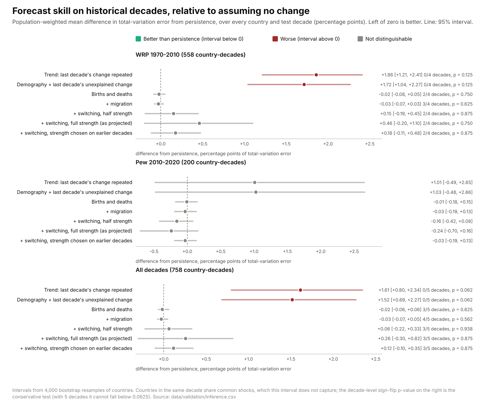

**Figure 1:** Forecast skill relative to persistence, country by country, with 95% bootstrap intervals and the decade-level sign-flip test, for the World Religion Project decades 1970–2010, Pew's decade 2010–2020 and all five together

### 5.2 The switching estimator

On the full evidence the replicate fits give δ = −0.22 (standard error 0.15), βd = 1.35 (0.11) and τu = 1.01 (standard error of log τu 0.16), and differ from one another by at most 0.15 standard errors; every country's importance sample keeps at least 65 effective draws of 512 (median 316). In the simulation study δ and βd are recovered well: bias −0.05 (± 0.03) and −0.01 (± 0.01), root mean squared errors 0.13 and 0.05, and 90% intervals that contain the true values in 90% and 100% of replications. The country spread τu is not: it is estimated too low (bias −0.11 ± 0.03 on the log scale, root mean squared error 0.17), and its 90% intervals contain the true value in only 13 of 20 replications. The repository's integrity check on the estimator, which requires at least 70% coverage and a bias no larger than the mean standard error (0.11), therefore fails for τu, narrowly on both counts, and we report the run with that failure rather than relax the check. The fitted differences between countries in switching are thus about 10% too small. This narrows the parameter spread of the runs and the country effects drawn in each, but much less the predictive intervals, which are built from past errors (Section 5.3), and the sensitivity analysis finds τu among the less influential inputs (Section 5.8). The overall level of disaffiliation is estimated about 0.4 standard errors too low, which, if anything, makes the history-fitted level of switching conservative. For Christians and Buddhists that level remains below the survey level (Table 3), and each run draws a weight between the two.

**Table 3:** People raised in a religion who have left it, per 100 adults aged 18–54 in 117 countries

| Raised                           | Level fitted to history | Survey level (Hackett et al. 2025) |
|----------------------------------|-------------------------|------------------------------------|
| Christian                        | 13.3                    | 17.1                               |
| Buddhist                         | 13.3                    | 22.1                               |
| Muslim                           | 1.5                     | 1.0                                |
| Hindu                            | 1.4                     | 1.0                                |
| Unaffiliated (joined a religion) | 7.5                     | 7.5                                |

### 5.3 Forecast error and predictive intervals

The error record gives b = 0.83 and β = 0.38: errors scale nearly in proportion to s(1 − s) and grow with horizon more slowly than a random walk (β = 0.5). Mean absolute standardized errors are 0.33, 0.43, 0.51 and 0.53 at 10, 20, 30 and 40 years. The model's Monte Carlo bands contain the observed share 23–25% of the time at nominal 90%. The error-calibrated intervals contain 88.4%, 86.6% and 84.7% of shares observed above zero at 10, 20 and 30 years, and 78.1% at 40 years, with interval scores about half as large (Table 4). For world totals of the observed countries, the 90% intervals contained 78.4% of 88 held-out values, against 18.2% for the Monte Carlo bands, and 76.8% of 56 in a real-time variant that uses only entries ending by the forecast origin. The intervals are therefore a few points too narrow for countries at 10–30 years, about 12 points too narrow at 40 years, where they rest on a single held-out decade, and less reliable for world totals, which rest on the common shocks of only five decades. The design of the validation matters: a leave-one-origin-out design, which keeps the decades a long forecast is scored on in the error model, reported 88–91% coverage for the same intervals.

**Table 4:** Out-of-sample calibration of 90% intervals for country-by-religion shares observed above zero

| Horizon  | Coverage, parameter only | Coverage, error-calibrated | Coverage, real time | Interval score, parameter only | Interval score, error-calibrated |
|----------|--------------------------|----------------------------|---------------------|--------------------------------|----------------------------------|
| 10 years | 23.2%                    | 88.4%                      | 88.9%               | 25.7                           | 12.2                             |
| 20 years | 24.4%                    | 86.6%                      | 85.0%               | 43.5                           | 18.8                             |
| 30 years | 24.7%                    | 84.7%                      | 88.7%               | 56.7                           | 26.3                             |
| 40 years | 25.2%                    | 78.1%                      | \-                  | 65.8                           | 33.2                             |

*Note:* No real-time forecast reaches 40 years. At 40 years the error model is refitted on a single held-out decade (Pew's 2010–2020).

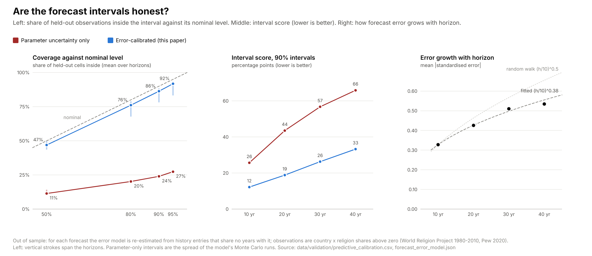

**Figure 2:** Coverage against nominal level, interval score by horizon, and the growth of forecast error with horizon

### 5.4 World religious composition to 2100

Table 5 and Figure 3 give world shares in the reference scenario, conditional on the United Nations' population projections. Islam becomes the largest religion: in the mean path the Muslim share passes the Christian share in 2035, its 2100 interval (36.6–43.2%) lies entirely above Christianity's (22.8–29.3%), and from 2055 the two intervals no longer overlap. The Christian share probably falls, by up to 6 points. The unaffiliated share falls in the world even though it rises inside most countries; its interval is skewed downward (predictive median 17.8%) because the countries closest to China in the error record, post-communist and East Asian, saw unaffiliated shares fall in 1970–2010. Table 6 compares three measures of uncertainty. The spread of the 40 runs, which reflects parameter uncertainty alone, is 7–20% of the width of the predictive interval in 2050 and 17–34% in 2100. The eight scenarios differ by less than the width of the predictive interval for every group; the closest case is Christianity in 2100, whose scenario means span 4.6 points against a predictive band of 6.4 points. What the scenarios vary matters less than what the model has historically got wrong.

**Table 5:** World religious composition, percent, reference scenario, with 90% predictive intervals

| Religion         | 2020 | 2050 | 90% interval | 2100 | 90% interval |
|------------------|------|------|--------------|------|--------------|
| Islam            | 25.6 | 31.7 | 29.7–34.2    | 39.2 | 36.6–43.2    |
| Christianity     | 28.8 | 27.8 | 25.7–29.9    | 26.1 | 22.8–29.3    |
| Unaffiliated     | 24.2 | 20.7 | 15.9–23.0    | 19.1 | 13.1–22.6    |
| Hinduism         | 14.9 | 14.5 | 12.0–16.2    | 12.0 | 8.4–13.4     |
| Buddhism         | 4.1  | 3.1  | 2.6–4.7      | 1.7  | 1.4–3.2      |
| Folk/traditional | 1.4  | 1.3  | 0.7–3.9      | 1.0  | 0.5–4.2      |
| Other            | 0.8  | 0.7  | 0.6–3.0      | 0.5  | 0.6–3.2      |
| Judaism          | 0.2  | 0.2  | 0.1–0.2      | 0.2  | 0.1–0.3      |

*Note:* The central value is the mean of the 40 model runs; the interval adds resampled forecast errors, which for the smallest groups are skewed upward, so for other religions the mean lies just below the interval.

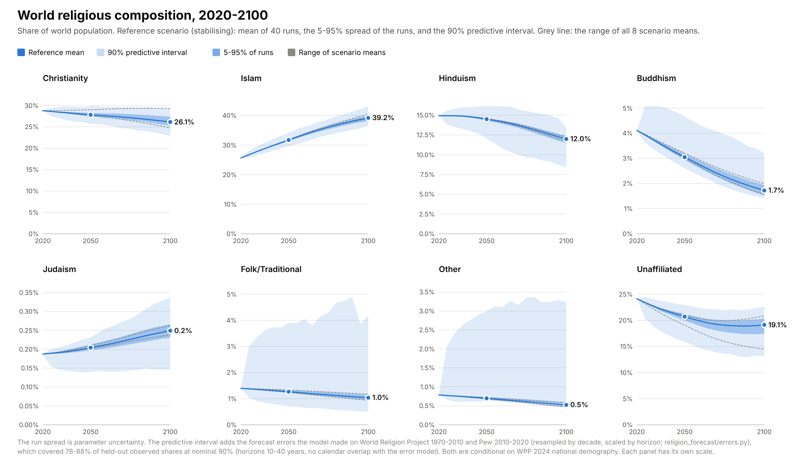

**Figure 3:** World shares 2020–2100, reference scenario: mean of 40 runs, the spread of the runs (parameter uncertainty), the 90% predictive interval, and the range of the eight scenario means

**Table 6:** Three measures of uncertainty in world shares, percentage points: the width of the 5–95% spread of the 40 runs (parameter uncertainty), the width of the 90% predictive interval, and the range of the eight scenario means

| Religion     | 2050: runs | 2050: predictive | 2050: scenarios | 2100: runs | 2100: predictive | 2100: scenarios |
|--------------|------------|------------------|-----------------|------------|------------------|-----------------|
| Islam        | 0.7        | 4.5              | 0.2             | 1.8        | 6.7              | 1.6             |
| Christianity | 0.8        | 4.1              | 1.4             | 2.2        | 6.4              | 4.6             |
| Unaffiliated | 1.2        | 7.0              | 2.0             | 2.9        | 9.6              | 6.4             |
| Hinduism     | 0.3        | 4.1              | 0.1             | 0.9        | 5.2              | 0.6             |
| Buddhism     | 0.2        | 2.1              | 0.2             | 0.4        | 1.8              | 0.4             |

### 5.5 Within countries or between them

An exact decomposition of each religion's change in world share, 2020–2100, separates change in countries' own shares at fixed 2020 population weights from change in the weights at fixed 2020 shares (Table 7, Figure 4). About three quarters of Islam's rise of 13.6 points (10.3 points) is the faster population growth of Muslim-majority countries. The unaffiliated share rises within countries by 7.7 points but falls in the world by 5.0 points, because the countries where it is concentrated grow more slowly. Christianity loses 8.9 points within countries and regains 6.5 points through the growth of sub-Saharan Africa. These results extend the finding of Hackett et al. (2015), that demography alone pushes the world's unaffiliated share down, to the end of the century, with switching measured rather than assumed.

**Table 7:** Change in world share 2020–2100, percentage points, reference scenario

| Religion     | Change | Within countries | Population weighting | Interaction |
|--------------|--------|------------------|----------------------|-------------|
| Islam        | +13.6  | +3.3             | +10.3                | 0.0         |
| Christianity | −2.6   | −8.9             | +6.5                 | −0.3        |
| Unaffiliated | −5.0   | +7.7             | −12.5                | −0.3        |
| Hinduism     | −3.0   | −0.7             | −2.4                 | +0.1        |
| Buddhism     | −2.4   | −1.2             | −1.7                 | +0.5        |

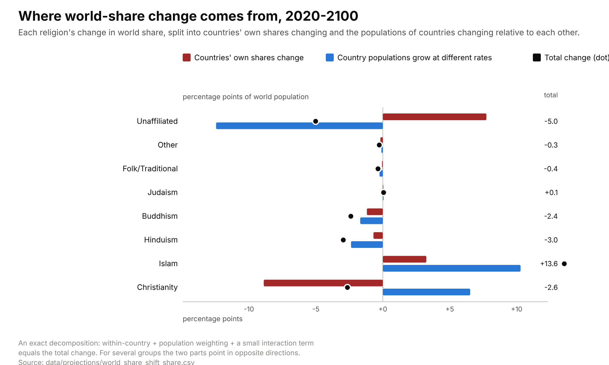

**Figure 4:** Change in world share 2020–2100 within countries and through population weighting

The decomposition also gives a natural benchmark for the century. If every country kept its 2020 composition and only national populations changed as the United Nations projects, the world would be 35.9% Muslim and 35.3% Christian in 2100, and Christianity would still be the larger group in 2050 (30.8% against 30.4%). Persistence, which the model could not beat over a decade, therefore already brings Islam level with Christianity by the end of the century. What the model adds is change within countries, which brings the crossover forward from the second half of the century to 2035: higher fertility and younger age structures among Muslims raise the Muslim share, and switching lowers the Christian share by about 2.4 points by 2050 and 7 points by 2100 (Table 8). Without switching, the paired runs put Islam at about 40% and Christianity at about 33% in 2100, so Islam's lead does not depend on switching; the size of Christianity's decline does. The persistence value for Christianity in 2100 lies outside the predictive interval (22.8–29.3%), a point taken up in Section 6.

### 5.6 What each mechanism contributes

Switching off one mechanism at a time, on identical random draws, measures what each contributes in 2100 (Table 8, Figure 5). Without switching, the world Christian share would be 7.1 points higher and the unaffiliated share 8.8 points lower, and some 34 fewer countries would change their largest religion. Within-country fertility differences add 2.3 points to the Muslim share. Migration moves no world share by more than about a third of a point, because migrants keep their religion; it changes national compositions and makes countries slightly more religiously mixed (rising rather than low migration raises population-weighted within-country Gini-Simpson diversity by 0.004 by 2100, in all 12 paired runs), a third of the effect if migrants mirrored their origin (0.013), because migrants mostly move where their religion is already common.

**Table 8:** Contribution of each mechanism in 2100: the full model minus the run without it, percentage points of world population, mean and 5–95% range of 12 paired runs

| Mechanism                              | Christianity        | Islam               | Unaffiliated         | Countries whose largest religion changes |
|----------------------------------------|---------------------|---------------------|----------------------|------------------------------------------|
| Religious switching                    | −7.1 (−8.0 to −6.0) | −0.7                | +8.8 (+7.8 to +10.6) | 34 (26 to 42)                            |
| Fertility differences within countries | −0.8                | +2.3 (+2.0 to +2.9) | −0.8                 | −2                                       |
| Migration                              | −0.2                | +0.3                | −0.3                 | −2                                       |

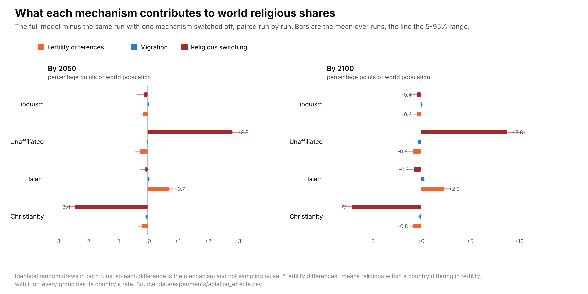

**Figure 5:** What switching, within-country fertility differences and migration contribute to world shares and to changes of the largest religion

### 5.7 Countries whose largest religion changes

With forecast error included, the largest religion is more likely than not to change by 2100 in 32 countries, and in 7 by 2050 (Figure 6). Almost all are Christian-majority countries in which the unaffiliated become the largest group: France (86%), the United Kingdom (83%), Australia (78%), Germany and Sweden (76%), Canada (72%), Chile (71%), Spain (66%), Brazil (59%) and the United States (56%). Mongolia and Singapore, where the unaffiliated overtake Buddhism, have the highest probabilities (92% and 88%), followed by Taiwan (82%), where they overtake folk religion, and North Macedonia's most likely change is to Islam (67%). Without forecast error the model would put France, the United Kingdom and Germany at 100%: it would state as nearly certain what it can only call likely. Figure 7 shows the most frequent largest religion across the 40 runs in 2100; on that parameter-only measure, the largest religion changes in 31 countries.

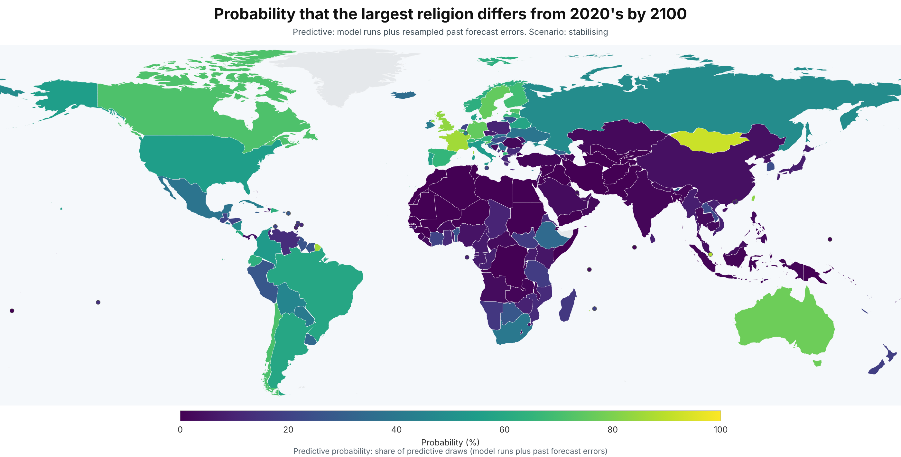

**Figure 6:** Predictive probability that a country's largest religion changes between 2020 and 2100

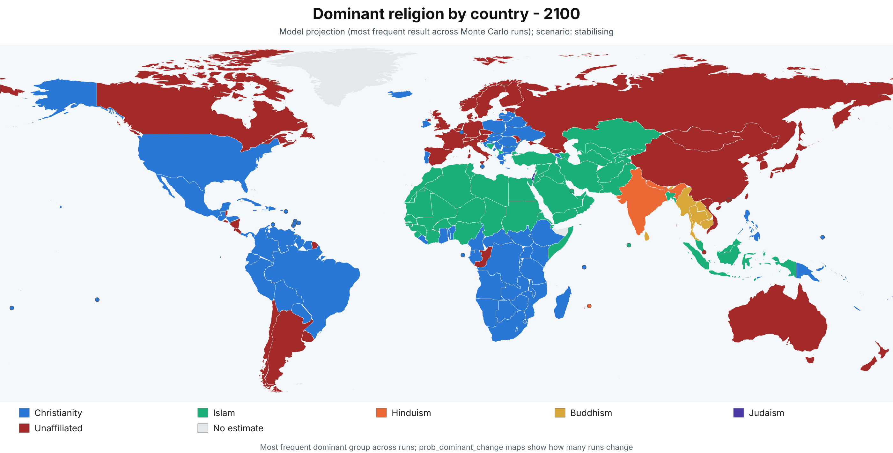

**Figure 7:** Largest religion by country in 2100, reference scenario (most frequent result across 40 runs). The 2050 map and the exploratory maps for 2200, 2500 and 3026 are in Appendix B.

Table 9 lists the 32 countries. Their intervals are wide: in most of them the 2100 share of either group could lie anywhere between about 10% and 70%, and the probability of change summarizes that uncertainty more usefully than the shares do. The countries fall into two groups. In France, the United Kingdom, Australia, Belgium, Estonia and Canada the change is already 49–67% likely by 2050. In Argentina, Belarus, Brazil, Colombia, Costa Rica, Ecuador, Italy and Portugal it depends on switching that has barely begun: the probability of change by 2050 is at most 5%, yet above 50% by 2100. In the United States and Brazil the change is close to an even chance: no religion ends about a point ahead of Christianity in the mean path, with intervals that overlap almost entirely (Table 10).

**Table 9:** Countries in which the largest religion is more likely than not to change between 2020 and 2100, reference scenario

| Country            | Largest, 2020    | Most likely largest, 2100 | P(change) by 2050 | P(change) by 2100 | P(change) by 2100 without forecast error | Share of the 2020 largest: 2020 → 2100 (90% interval) | Share of the new largest: 2020 → 2100 (90% interval) |
|--------------------|------------------|---------------------------|-------------------|-------------------|------------------------------------------|-------------------------------------------------------|------------------------------------------------------|
| Mongolia           | Buddhism         | Unaffiliated              | 71%               | 92%               | 100%                                     | 51 → 16 (4–52)                                        | 41 → 74 (31–88)                                      |
| Singapore          | Buddhism         | Unaffiliated              | 65%               | 88%               | 100%                                     | 31 → 14 (5–40)                                        | 20 → 34 (0–54)                                       |
| France             | Christianity     | Unaffiliated              | 60%               | 86%               | 100%                                     | 46 → 20 (8–48)                                        | 43 → 53 (6–72)                                       |
| United Kingdom     | Christianity     | Unaffiliated              | 54%               | 83%               | 100%                                     | 49 → 21 (8–51)                                        | 40 → 48 (0–68)                                       |
| Taiwan             | Folk/traditional | Unaffiliated              | 40%               | 82%               | 82%                                      | 51 → 30 (0–48)                                        | 23 → 50 (5–83)                                       |
| Australia          | Christianity     | Unaffiliated              | 67%               | 78%               | 100%                                     | 47 → 23 (8–50)                                        | 42 → 49 (0–72)                                       |
| Sweden             | Christianity     | Unaffiliated              | 35%               | 76%               | 100%                                     | 61 → 24 (10–50)                                       | 29 → 46 (0–69)                                       |
| Germany            | Christianity     | Unaffiliated              | 45%               | 76%               | 100%                                     | 56 → 25 (10–60)                                       | 36 → 52 (4–75)                                       |
| Belgium            | Christianity     | Unaffiliated              | 59%               | 75%               | 100%                                     | 51 → 25 (10–57)                                       | 39 → 53 (5–75)                                       |
| Slovenia           | Christianity     | Unaffiliated              | 29%               | 73%               | 98%                                      | 65 → 33 (10–81)                                       | 32 → 58 (10–82)                                      |
| Estonia            | Christianity     | Unaffiliated              | 62%               | 72%               | 82%                                      | 53 → 35 (7–79)                                        | 44 → 58 (8–86)                                       |
| Canada             | Christianity     | Unaffiliated              | 49%               | 72%               | 100%                                     | 53 → 25 (10–55)                                       | 35 → 42 (1–67)                                       |
| Chile              | Christianity     | Unaffiliated              | 26%               | 71%               | 90%                                      | 68 → 41 (13–77)                                       | 30 → 57 (8–85)                                       |
| Finland            | Christianity     | Unaffiliated              | 22%               | 69%               | 100%                                     | 72 → 32 (7–66)                                        | 25 → 53 (2–80)                                       |
| Cabo Verde         | Christianity     | Unaffiliated              | 16%               | 67%               | 78%                                      | 78 → 41 (9–82)                                        | 21 → 52 (3–82)                                       |
| North Macedonia    | Christianity     | Islam                     | 7%                | 67%               | 88%                                      | 65 → 39 (17–59)                                       | 35 → 52 (32–79)                                      |
| Switzerland        | Christianity     | Unaffiliated              | 31%               | 66%               | 100%                                     | 62 → 30 (12–63)                                       | 31 → 50 (0–75)                                       |
| Latvia             | Christianity     | Unaffiliated              | 13%               | 66%               | 82%                                      | 77 → 42 (10–80)                                       | 17 → 52 (8–79)                                       |
| Spain              | Christianity     | Unaffiliated              | 21%               | 66%               | 100%                                     | 69 → 32 (13–67)                                       | 26 → 50 (2–76)                                       |
| Austria            | Christianity     | Unaffiliated              | 15%               | 63%               | 100%                                     | 68 → 29 (13–58)                                       | 22 → 47 (0–72)                                       |
| Ecuador            | Christianity     | Unaffiliated              | 3%                | 63%               | 70%                                      | 89 → 48 (18–75)                                       | 8 → 49 (15–79)                                       |
| Dominican Republic | Christianity     | Unaffiliated              | 12%               | 63%               | 70%                                      | 78 → 45 (14–86)                                       | 20 → 52 (7–82)                                       |
| Norway             | Christianity     | Unaffiliated              | 18%               | 63%               | 95%                                      | 71 → 32 (12–63)                                       | 22 → 48 (0–76)                                       |
| Costa Rica         | Christianity     | Unaffiliated              | 3%                | 61%               | 65%                                      | 88 → 47 (16–77)                                       | 10 → 50 (16–81)                                      |
| Argentina          | Christianity     | Unaffiliated              | 0%                | 59%               | 57%                                      | 88 → 48 (17–76)                                       | 9 → 49 (11–79)                                       |
| Brazil             | Christianity     | Unaffiliated              | 5%                | 59%               | 62%                                      | 81 → 47 (13–73)                                       | 13 → 48 (10–76)                                      |
| Belarus            | Christianity     | Unaffiliated              | 1%                | 59%               | 62%                                      | 85 → 48 (12–80)                                       | 14 → 49 (10–85)                                      |
| Portugal           | Christianity     | Unaffiliated              | 0%                | 57%               | 52%                                      | 85 → 47 (13–82)                                       | 14 → 46 (5–80)                                       |
| Denmark            | Christianity     | Unaffiliated              | 6%                | 57%               | 82%                                      | 77 → 36 (11–65)                                       | 17 → 45 (4–72)                                       |
| United States      | Christianity     | Unaffiliated              | 23%               | 56%               | 60%                                      | 64 → 41 (9–68)                                        | 30 → 42 (6–74)                                       |
| Italy              | Christianity     | Unaffiliated              | 3%                | 54%               | 70%                                      | 80 → 39 (12–68)                                       | 13 → 42 (0–73)                                       |
| Colombia           | Christianity     | Unaffiliated              | 2%                | 54%               | 42%                                      | 86 → 51 (16–85)                                       | 10 → 46 (6–75)                                       |

*Note:* Probabilities include forecast error (the predictive distribution) unless stated. Shares are percent of the national population; the 2100 value is the mean of the predictive distribution, which can lie close to one end of its interval when the distribution is skewed.

Table 10 gives the twelve most populous countries in 2100, which together hold 54% of the world's population and so do much to drive the world totals. India remains about three quarters Hindu, China overwhelmingly unaffiliated, and Pakistan, Indonesia, Bangladesh and Egypt overwhelmingly Muslim. Nigeria, whose population more than doubles, becomes more Muslim (from 56% to 70%) almost entirely through births (+9.7 points) and deaths (+4.3 points), which reflect the higher fertility and younger age structure of Nigerian Muslims; switching contributes almost nothing. The close cases are Ethiopia, where the Christian and Muslim shares are nearly equal in 2100 (44% and 43%), and the United States and Brazil, where no religion overtakes Christianity in the mean path (42% against 41%, and 48% against 47%) with intervals that overlap almost entirely.

**Table 10:** The twelve most populous countries in 2100: population and the two largest religious groups, reference scenario

| Country       | Population 2020 (millions) | Population 2100 (millions) | Largest group in 2100: 2020 → 2100 (90% interval) | Second group in 2100: 2020 → 2100 (90% interval) |
|---------------|----------------------------|----------------------------|---------------------------------------------------|--------------------------------------------------|
| India         | 1,403                      | 1,508                      | Hinduism 79 → 74 (51–83)                          | Islam 15 → 18 (7–41)                             |
| China         | 1,426                      | 632                        | Unaffiliated 90 → 86 (50–95)                      | Islam 2 → 4 (0–15)                               |
| Pakistan      | 235                        | 536                        | Islam 97 → 96 (89–100)                            | Hinduism 2 → 2 (0–3)                             |
| Nigeria       | 214                        | 477                        | Islam 56 → 70 (49–94)                             | Christianity 43 → 27 (4–49)                      |
| DR Congo      | 96                         | 433                        | Christianity 96 → 87 (62–98)                      | Unaffiliated 1 → 8 (0–27)                        |
| United States | 339                        | 407                        | Unaffiliated 30 → 42 (6–74)                       | Christianity 64 → 41 (9–68)                      |
| Ethiopia      | 119                        | 366                        | Christianity 62 → 44 (25–65)                      | Islam 36 → 43 (26–56)                            |
| Indonesia     | 275                        | 295                        | Islam 87 → 86 (75–99)                             | Christianity 10 → 7 (0–15)                       |
| Tanzania      | 61                         | 264                        | Christianity 65 → 51 (30–70)                      | Islam 30 → 37 (21–51)                            |
| Bangladesh    | 166                        | 215                        | Islam 91 → 90 (78–99)                             | Hinduism 8 → 6 (0–9)                             |
| Egypt         | 109                        | 201                        | Islam 95 → 92 (80–100)                            | Unaffiliated 0 → 4 (0–17)                        |
| Brazil        | 209                        | 164                        | Unaffiliated 13 → 48 (10–76)                      | Christianity 81 → 47 (13–73)                     |

*Note:* Population follows the United Nations (2024a) medium variant through the projection; shares are percent, with the 2100 mean of the predictive distribution and its 90% interval.

### 5.8 What the results depend on

A global sensitivity analysis on 120 further runs of the reference scenario regresses each outcome on the ranks of all drawn parameters, including each run's switching hyperparameters. A placebo, drawn like a parameter but used nowhere, reaches a standardized coefficient of 0.12, the noise floor of 120 runs. The weight between the history-fitted and the survey level of switching is the most influential assumption for the Christian share (−0.70 in 2050, −0.60 in 2100) and for the number of countries whose largest religion changes (+0.65). For the Muslim share in 2050 the most influential input is the strength of the within-country age difference between religions (+0.73), whose inputs are the median ages by religion in 2010 published by Pew Research Center (2012). The half-life of fertility gaps matters by 2100 (+0.43). The estimation uncertainty of the switching hyperparameters matters mainly for the unaffiliated share, where the level of disaffiliation δ and the development gradient βd (+0.32 and +0.26 in 2050) are about as influential as the survey weight (+0.37), and for the number of countries that change (βd +0.49); for the Christian and Muslim shares their coefficients are at most 0.20. The country spread τu, which the estimator recovers worst (Section 5.2), reaches at most 0.12 for these world shares and 0.08 for the number of countries that change (Table 11; Appendix Figure A5).

**Table 11:** Global sensitivity analysis: parameters whose standardized rank regression coefficient is at least 0.20 in absolute value, 120 runs of the reference scenario

| Outcome                                        | R²   | Parameters (coefficient)                                                                                                                                                                                                  |
|------------------------------------------------|------|---------------------------------------------------------------------------------------------------------------------------------------------------------------------------------------------------------------------------|
| World Christian share, 2050                    | 0.70 | weight on the survey level of switching −0.70; development gradient βd −0.20                                                                                                                                   |
| World Christian share, 2100                    | 0.57 | weight on the survey level of switching −0.60                                                                                                                                                                             |
| World Muslim share, 2050                       | 0.77 | within-country age difference between religions +0.73; weight on the survey level of switching +0.30; damping of world fertility ratios +0.20                                                                             |
| World Muslim share, 2100                       | 0.67 | half-life of fertility gaps +0.43; weight on the survey level of switching +0.38; within-country age difference between religions +0.34; damping of world fertility ratios +0.22; softness of the migration margins +0.20 |
| World unaffiliated share, 2050                 | 0.49 | weight on the survey level of switching +0.37; level of disaffiliation δ +0.32; development gradient βd +0.26; within-country age difference between religions −0.20                                           |
| World unaffiliated share, 2100                 | 0.42 | level of disaffiliation δ +0.31; development gradient βd +0.29; weight on the survey level of switching +0.25; half-life of fertility gaps −0.22                                                               |
| Countries whose largest religion changes, 2100 | 0.70 | weight on the survey level of switching +0.65; development gradient βd +0.49                                                                                                                                   |

*Note:* A placebo parameter reaches at most 0.12 for outcomes in 2050 and 2100. R² is that of the rank regression on all drawn parameters.

### 5.9 Migration and an independent benchmark

Starting from the 1990 foreign-born stocks, the migration model reproduces each country's 2020 foreign-born share with a population-weighted error of 0.97 points, against 1.76 for the 1990 share held constant (correlation with the United Nations 0.91), and the origin mix of simulated 1990–2020 arrivals in the 25 largest destinations correlates 0.67 with the growth of bilateral stocks. Some projected corridors are much larger than their 2020 stocks, notably Pakistan into the United Kingdom (36% of arrivals in 2020–2050 against 8% of the stock), so results for such destinations, including the United Kingdom's projected Muslim share of 26% in 2100, should be read with care. Bounding the minority effect matters for small groups: Christians in Pakistan go from 1.3% in 2020 to 0.8% in 2050, where an unbounded effect gave 0.4%.

Table 12 compares the projected change in world shares, 2020–2050, with Pew Research Center (2015). The two separately built models agree on the size of every group's change within 1.3 points and on its direction for six of the eight groups. They disagree far more about where 2020 started: Pew's 2015 estimate of 2020 differs from Pew's later data by up to 8.6 points (the unaffiliated), mostly because China is classified differently. No projection can be scored more precisely than its measurements agree.

**Table 12:** Change in world share 2020–2050, percentage points, compared with Pew Research Center (2015)

| Religion         | This model | Pew 2015 | Difference | Difference in 2020 level |
|------------------|------------|----------|------------|--------------------------|
| Islam            | +6.1       | +4.8     | +1.3       | +0.7                     |
| Unaffiliated     | −3.4       | −2.4     | −1.1       | +8.6                     |
| Christianity     | −0.9       | +0.2     | −1.2       | −2.3                     |
| Buddhism         | −1.1       | −1.4     | +0.3       | −2.5                     |
| Folk/traditional | −0.1       | −0.8     | +0.7       | −4.2                     |
| Hinduism         | −0.4       | −0.3     | −0.1       | −0.2                     |

Table 13 compares the projection with the newest projections from Pew's 2020 base (Hackett et al. 2026), built separately from this model but from the same 2020 estimates and partly the same survey evidence on switching. Both put Muslims ahead of Christians by 2035, and every one of Pew's 2070 shares lies inside the 90% intervals here. The agreement holds by decade and by country. All of Pew's world shares for 2030–2070 lie inside the intervals, and in 2050 the largest religion agrees in 196 of 200 countries (the exceptions are Canada, Estonia, Mongolia and Singapore), 98.7% of Pew's 1,200 country-by-group shares lie inside the intervals, and the population-weighted total-variation distance between the two projections is 3.0 points. The largest country differences are in Belarus (16 points) and Bolivia, Costa Rica and Ecuador (15 points), where this projection expects much more disaffiliation than Pew does. The two differ mainly in the groups that switching moves: this projection has 1.8 points fewer Christians and 2.3 points more unaffiliated people in 2070. In Pew's projection, removing switching raises the Christian share by only 1.4 points by 2070, whereas switching lowers it here by about 2.4 points by 2050 and 7 points by 2100 (Table 8). One likely reason is that disaffiliation here rises as countries develop (βd), while Pew holds recent rates constant; Pew itself notes that its projections may understate the growth of the unaffiliated if more countries enter a secular transition (Hackett et al. 2026). Both projections agree that Islam's lead does not depend on switching.

**Table 13:** World religious composition in 2070, percent: this projection (reference scenario, mean and 90% predictive interval) and Hackett et al. (2026), with and without switching

| Religion                                  | 2020 | This projection, 2070 | 90% interval | Hackett et al. (2026), 2070 | Hackett et al. (2026), 2070, without switching |
|-------------------------------------------|------|-----------------------|--------------|-----------------------------|------------------------------------------------|
| Islam                                     | 25.6 | 35.3                  | 32.8–38.0    | 35.8                        | 36.0                                           |
| Christianity                              | 28.8 | 27.3                  | 24.6–29.7    | 29.1                        | 30.5                                           |
| Unaffiliated                              | 24.2 | 19.3                  | 13.8–22.1    | 17.0                        | 15.4                                           |
| Hinduism                                  | 14.9 | 13.7                  | 10.0–15.7    | 13.6                        | 13.6                                           |
| Buddhism                                  | 4.1  | 2.4                   | 2.0–4.1      | 2.5                         | 2.5                                            |
| Other religions, including folk religions | 2.2  | 1.8                   | \-           | 1.9                         | 1.9                                            |
| Judaism                                   | 0.2  | 0.2                   | 0.14–0.27    | 0.17                        | 0.2                                            |

*Note:* Hackett et al. (2026) include folk religions among other religions; the interval for the combined group is not computed here. Their 2020 shares are the same as those used here.

### 5.10 Exploratory long-run scenarios

Beyond 2100 the projection shows what a stated set of long-run assumptions implies, not what will happen, and carries no predictive intervals. Under the reference assumptions (Table 14; maps in Appendix Figures A1–A4), people with no religion become the largest group in much of the Americas and Europe by 2200, including the United States, Brazil and Mexico, and lead in 74 countries against 57 for Christianity, while Islam leads in 61. By 3026 the world divides between Islam, the largest religion in 98 countries with 42% of the world's population, and the unaffiliated, the largest in 80 countries with 32%; Christianity remains the largest in 19 countries, among them the Philippines, DR Congo, Angola, Zambia and Zimbabwe, Hinduism in India and Nepal, and Buddhism in Cambodia. The scenarios diverge strongly over such periods: by 3026 the eight scenario means differ by up to 66 points for the Muslim and the unaffiliated shares.

**Table 14:** Countries (of 200) in which each religion is the largest, and world shares (percent), reference scenario; 2200 and later are exploratory

|                           | 2020 | 2050 | 2100 | 2200 | 2500 | 3026 |
|---------------------------|------|------|------|------|------|------|
| Countries, Christianity   | 122  | 117  | 94   | 57   | 29   | 19   |
| Countries, Islam          | 54   | 54   | 55   | 61   | 80   | 98   |
| Countries, unaffiliated   | 11   | 18   | 41   | 74   | 88   | 80   |
| Countries, other groups   | 13   | 11   | 10   | 8    | 3    | 3    |
| World share, Islam        | 25.6 | 31.7 | 39.2 | 43.7 | 44.1 | 42.0 |
| World share, Christianity | 28.8 | 27.8 | 26.1 | 22.9 | 21.1 | 19.8 |
| World share, unaffiliated | 24.2 | 20.7 | 19.1 | 22.6 | 27.6 | 32.2 |
| World share, Hinduism     | 14.9 | 14.5 | 12.0 | 8.5  | 5.2  | 3.9  |

## 6 Discussion

Three results stand out, and two concern what the model cannot do. First, a careful mechanistic projection is no better than assuming no change over ten years, and its demographic part is at most about 2% better. This is not a failure of a particular specification. Births, deaths, aging and migration move religious shares slowly, and most of what changes a country's measured composition within a decade is either switching, which the historical record identifies poorly, or differences between rounds of measurement, which no model of behavior can forecast. Repeating recent change is 35% worse than persistence, and switching fitted freely to historical change fails in the World Religion Project decades for the same reason: much country-level change between rounds of data does not continue. For users of religious projections, the implication is that country-level statements over one or two decades should be made with great caution.

Second, the uncertainty a projection reports from its own parameters is the wrong uncertainty. The Monte Carlo bands contain the truth about a quarter as often as they claim, even though, as here, the estimation uncertainty of the switching model is carried into every run. An empirical model of the projection's own past errors brings coverage within a few points of nominal at horizons up to 30 years, a result in the spirit of the out-of-sample validation of Raftery et al. (2012) and of the ex-post evaluations of Keilman (1998, 2001). How such intervals are validated matters as much as how they are built: leaving out only the forecast origin overstated coverage by up to five points for countries at 10–30 years, by 13 points at 40 years and by 12 points for world totals. Like earlier error-based intervals for population totals, ours assume that the distribution of errors is stable over time (Smith and Sincich 1988); five decades of record allow that assumption to be checked only as far as the 78–89% coverage achieved out of sample in calendar time.

Third, conditional on the United Nations' demography and stated assumptions, the projection says something definite about the century, and it says it mainly through population growth: with every country's composition frozen, population growth alone brings Islam level with Christianity by 2100, and change within countries decides the margin and the timing. Three quarters of Islam's projected rise is the faster growth of Muslim-majority countries, and the unaffiliated share falls in the world while rising in most countries, consistent with the demographic counterweights to secularization identified by Skirbekk, Kaufmann, and Goujon (2010), Kaufmann, Goujon, and Skirbekk (2012) and Hackett et al. (2015). On the timing of Islam's rise the projection agrees with the newest deterministic projection (Hackett et al. 2026), every 2070 share of which falls inside this projection's intervals; the two differ mainly in how much switching they expect. Switching is what changes individual countries, in line with the generational decline of affiliation documented by Voas and Chaves (2016), and its level is both the assumption the results are most sensitive to and the one history identifies least well. Measuring it directly, by cohort and country, is the most valuable data investment for this field. The same point limits how the intervals should be read. They are built from errors of up to 40 years and centered on the model's mechanisms, and for Christianity in 2100 they exclude the persistence benchmark (Section 5.5). They therefore describe the uncertainty that remains if switching and fertility differences continue broadly as modeled, not uncertainty about whether they continue; surveys document ongoing switching directly (Hackett et al. 2025), and in Pew's own decade 2010–2020 full-strength switching was the most accurate variant, but the historical record used here could not confirm its pace with statistical confidence.

A methodological lesson runs through the development of the model. Several errors changed substantive conclusions before they were found: a survey likelihood that counted respondents several times over, which manufactured most of an apparent disagreement between survey and historical evidence; importance samplers that degenerated where survey evidence was sharp; an optimizer that stalled at a bound; a switching exposure computed one age group too young, which understated switching by 10–20% in young populations; and an emigration rate for minorities that, left unbounded, emptied small minorities from countries of high emigration. Each was found by checking the estimator and the mechanism against exact computation or simulation rather than by inspecting the output, and the same checks flag one weakness that remains: the spread of switching between countries is estimated about 10% too low (Section 5.2). We recommend such checks for any model of this kind.

For producers of religious projections, five practices follow from these results: evaluate the projection against persistence on decades that can be checked; compare long-run results with the benchmark in which every country keeps its current composition; report intervals built from past errors rather than from parameter ranges alone; treat the level of switching as a principal dimension of the scenarios, since it is both the most influential assumption and the least well identified; and report how much of the projected change in world shares comes from changes within countries and how much from differences in population growth between them.

## 7 Limitations

The evaluation and the intervals are conditional on national demography: the historical decades use the United Nations' estimates, not the projections available at the time, and the projection takes the medium variant as given, so uncertainty in national fertility, the main driver of world totals through population weighting, is absent. Some inputs of the historical runs were measured later (the religion-of-migrants parameters and the religion-specific fertility ratios), although none is fitted to the shares being forecast. Calibration can be checked to 40 years, where it rests on a single held-out decade and the intervals are too narrow; the growth of error is extrapolated beyond that, and the error record's measurement noise is assumed to represent future measurement. The intervals also assume that the distribution of errors observed in 1970–2020 applies to the future, and, because the error record comes from the World Religion Project while the projection starts from Pew's estimates, that the measurement errors of the two sources are similar; persistence errs by 3.44 points in Pew's decade 2010–2020, against 4.41 in World Religion Project decades, which suggests errors of a similar order, somewhat smaller in Pew's data. They are conditional on the model's mechanisms and do not contain the persistence benchmark for the Christian share in 2100. Switching is identified by 67 survey cells in 33 countries and by historical change that the tests show to be a poor guide, and the simulation study finds the spread of switching between countries underestimated. The religion of migrants is calibrated to aggregate figures, only one of which describes the emigrants of a single country, so the minority effect is bounded by assumption. The model has no intermarriage, no religion-specific mortality, no sub-national variation and no shock process for conflict, persecution or state policy, and it measures affiliation rather than belief. Beyond 2100 every input is an assumption, and those horizons are reported as exploratory only.

## 8 Conclusions

A probabilistic projection of religious composition, evaluated on the decades it can be tested against, cannot beat persistence at decadal horizons, but with intervals built from its own past errors it still supports clear statements about the century. Islam becomes the world's largest religion: population growth alone, with every country's composition frozen, brings it level with Christianity by 2100, and its lead survives without switching. The unaffiliated become the largest group in a growing number of countries, and that result, like the size of Christianity's decline, depends on switching, the mechanism the historical record identifies least well. Projections of religious composition should report tested uncertainty and simple benchmarks, and their users should weigh the long-run world picture far more heavily than near-term statements about individual countries. Natural extensions are to make national demography probabilistic, to measure switching by cohort and country, and to ask whether countries whose dominant religion changes also change their political alignments.

## Author contributions

Conrad Flick conceived the study, designed the model, developed the software, prepared the data, carried out the analysis, made the figures and wrote the manuscript (conceptualization, methodology, software, data curation, formal analysis, visualization, writing: original draft, writing: review and editing). Jingyu Huang checked and revised the manuscript (writing: review and editing). Taleh Malikov revised the manuscript (writing: review and editing). All authors approved the final version.

## Funding

This research received no specific funding.

## Data and code availability

All code, the inputs transcribed from published sources and the outputs of the run reported here are openly available at github.com/FLICK11-hash/religion_world_map_predictor. The full pipeline runs with one command (python run.py all, about 35 minutes on four cores) and records the commit it was run from; integrity checks and a test suite run on every change; the run reported here fails one integrity check, the recovery of τu in the simulation study (Section 5.2), which the repository records. The code is written in Python, with the exact package versions pinned in the repository. Pew's country dataset (Hackett et al. 2026), used for the 2010 and 2020 estimates and the comparison in Section 5.9, requires a free account and is not redistributed; the code reads it from the local data folder, and scripts/benchmark_pew2026.py reproduces the comparison. \[Archive a tagged release, for example on Zenodo, and cite its DOI; choose a license.\]

## Use of AI tools

In line with the journal's policy on generative AI, we disclose that most of the statistical code and documentation for this study, and drafts of parts of this manuscript, were produced with an AI coding assistant under the direction of the first author, who specified the research questions and the model and keeps a record of the interactions with the tool \[confirm that the session records are saved\]. The first author reviewed and tested the code and checked the reported numbers against the outputs of the code; all authors reviewed the manuscript and take full responsibility for its content. Every reported number is produced by the code from documented inputs.

## References

Alho, J.M. and Spencer, B.D. (2005). Statistical demography and forecasting. New York: Springer.

Gneiting, T. and Raftery, A.E. (2007). Strictly proper scoring rules, prediction, and estimation. Journal of the American Statistical Association 102(477): 359–378. doi:10.1198/016214506000001437.

Hackett, C., Stonawski, M., Potančoková, M., Grim, B.J., and Skirbekk, V. (2015). The future size of religiously affiliated and unaffiliated populations. Demographic Research 32(27): 829–842. doi:10.4054/DemRes.2015.32.27.

Hackett, C., Stonawski, M., Tong, Y., Kramer, S., Shi, A., and Fahmy, D. (2025). How the global religious landscape changed from 2010 to 2020. Washington, D.C.: Pew Research Center. doi:10.58094/fj71-ny11.

Hackett, C., Stonawski, M., Tong, Y., Kramer, S., Leppert, R., and Diamant, J. (2026). The future of world religions: Population growth projections, 2020–2070. Washington, D.C.: Pew Research Center. doi:10.58094/qx43-nn81.

Hesterberg, T. (1995). Weighted average importance sampling and defensive mixture distributions. Technometrics 37(2): 185–194. doi:10.1080/00401706.1995.10484303.

Kass, R.E. and Steffey, D. (1989). Approximate Bayesian inference in conditionally independent hierarchical models (parametric empirical Bayes models). Journal of the American Statistical Association 84(407): 717–726. doi:10.1080/01621459.1989.10478825.

Kaufmann, E., Goujon, A., and Skirbekk, V. (2012). The end of secularization in Europe? A socio-demographic perspective. Sociology of Religion 73(1): 69–91. doi:10.1093/socrel/srr033.

Keilman, N. (1998). How accurate are the United Nations world population projections? In: Lutz, W., Vaupel, J.W., and Ahlburg, D.A. (eds.). Frontiers of population forecasting. Population and Development Review 24(Supplement): 15–41.

Keilman, N. (2001). Data quality and accuracy of United Nations population projections, 1950–95. Population Studies 55(2): 149–164. doi:10.1080/00324720127686.

Keilman, N., Pham, D.Q., and Hetland, A. (2002). Why population forecasts should be probabilistic: Illustrated by the case of Norway. Demographic Research 6(15): 409–454. doi:10.4054/DemRes.2002.6.15.

Lall, U. and Sharma, A. (1996). A nearest neighbor bootstrap for resampling hydrologic time series. Water Resources Research 32(3): 679–693. doi:10.1029/95WR02966.

Maoz, Z. and Henderson, E.A. (2013). The World Religion Dataset, 1945–2010: Logic, estimates, and trends. International Interactions 39(3): 265–291. doi:10.1080/03050629.2013.782306.

Pew Research Center (2012). The global religious landscape: A report on the size and distribution of the world's major religious groups as of 2010. Washington, D.C.: Pew Research Center. https://www.pewresearch.org/religion/2012/12/18/global-religious-landscape-exec/.

Pew Research Center (2015). The future of world religions: Population growth projections, 2010–2050. Washington, D.C.: Pew Research Center. https://www.pewresearch.org/religion/2015/04/02/religious-projections-2010-2050/.

Pew Research Center (2024). The religious composition of the world's migrants. Washington, D.C.: Pew Research Center. https://www.pewresearch.org/religion/2024/08/19/the-religious-composition-of-the-worlds-migrants/.

Raftery, A.E., Li, N., Ševčíková, H., Gerland, P., and Heilig, G.K. (2012). Bayesian probabilistic population projections for all countries. Proceedings of the National Academy of Sciences 109(35): 13915–13921. doi:10.1073/pnas.1211452109.

Skirbekk, V., Kaufmann, E., and Goujon, A. (2010). Secularism, fundamentalism, or Catholicism? The religious composition of the United States to 2043. Journal for the Scientific Study of Religion 49(2): 293–310. doi:10.1111/j.1468-5906.2010.01510.x.

Smith, S.K. and Sincich, T. (1988). Stability over time in the distribution of population forecast errors. Demography 25(3): 461–474. doi:10.2307/2061544.

Stoto, M.A. (1983). The accuracy of population projections. Journal of the American Statistical Association 78(381): 13–20. doi:10.1080/01621459.1983.10477916.

United Nations (2024a). World population prospects 2024. New York: United Nations, Department of Economic and Social Affairs, Population Division. https://population.un.org/wpp/.

United Nations (2024b). International migrant stock 2024. New York: United Nations, Department of Economic and Social Affairs, Population Division. https://www.un.org/development/desa/pd/content/international-migrant-stock.

Voas, D. and Chaves, M. (2016). Is the United States a counterexample to the secularization thesis? American Journal of Sociology 121(5): 1517–1556. doi:10.1086/684202.

## Appendix A: Notation, parameters, scenarios and data

**Table A1:** Notation

| Symbol                                           | Meaning                                                                             |
|--------------------------------------------------|-------------------------------------------------------------------------------------|
| c, r, g, a                                       | country (200), religion (8), migrant generation (3), five-year age group (17)       |
| Ncrga(t)                              | persons in country c, religion r, generation g and age group a at time t            |
| sck                                   | share of religion k in the population of country c                                  |
| Bcrg, Wcrga                | births to women of religion r and generation g; woman-years at age a                |
| TFRc, fc(a), kc | national total fertility (United Nations), fertility schedule, normalizing constant |
| relcrg                                | fertility of religion r and generation g relative to the national level             |
| dcr, vcr, ac    | lifetime probabilities of disaffiliation, conversion and affiliation                |
| zc                                    | development index (standardized life expectancy and negative log fertility)         |
| μ, τ, ξ                                          | prior centers, spreads and standard normal country effects of the switching model   |
| H = (δ, βd, τu)            | switching hyperparameters estimated by empirical Bayes                              |
| h, e, u                                          | forecast horizon in years, forecast error of a share, standardized error            |
| b, β                                             | exponents of the error model in the share and the horizon                           |
| α, ISα                                | nominal miscoverage (0.10 for 90% intervals) and the interval score                 |

**Table A2:** Main drawn parameters and their ranges (every run draws each from a uniform distribution over its range)

| Parameter                                                                                      | Range                         | Basis                                                           |
|------------------------------------------------------------------------------------------------|-------------------------------|-----------------------------------------------------------------|
| Damping of world fertility ratios                                                              | 0.3–0.7                       | Assumption; history tests cannot identify it                    |
| Damping of regional fertility ratios                                                           | 0.6–1.0                       | Assumption                                                      |
| Half-life of fertility gaps between religions                                                  | 30–80 years                   | Assumption                                                      |
| Within-country age difference between religions, as a fraction of the global gap in median age | 0–0.2                         | Assumption; median ages from Pew Research Center (2012)         |
| Weight on the survey level of switching                                                        | 0–1                           | Spans the disagreement between survey and historical evidence   |
| Switching of the first and second generation, relative to natives                              | 0.3–0.6 and 0.4–0.8           | Published retention among immigrants and their children         |
| Bound on minorities' emigration rate, relative to the origin average                           | 3–6                           | Assumption, checked against the religion of India-born migrants |
| Softness of the migration margins                                                              | 0.5–1.0                       | 1990–2020 corridor test fits best near 0.75                     |
| Two-way circulation, per year                                                                  | 0–0.0003 of population        | Calibrated on 1990–2020 foreign-born stocks                     |
| Long-run fertility after 2100, and its half-life                                               | 1.6–2.1; 50–150 years         | Assumption                                                      |
| Life expectancy gain after 2100, and its cap                                                   | 0.02–0.06 years a year; 90–95 | Assumption                                                      |

**Table A3:** Scenarios

| Scenario                  | Switching                                                                | Migration                                                       | Fertility gaps |
|---------------------------|--------------------------------------------------------------------------|-----------------------------------------------------------------|----------------|
| Stabilizing (reference)   | Development link to 2100, then fades (half-life 150 years, floor 0.3)    | UN to 2100, then 2100 rates                                     | Converge       |
| Continued secularization  | Development link throughout, +0.6 logit per century to 2300, less return | As reference                                                    | Converge       |
| High retention            | More retention, more return, −0.3 logit per century                      | As reference                                                    | Converge       |
| Rising migration          | As reference                                                             | ×2 by 2100, ×3 by 2200, ×4 by 3030                              | Converge       |
| Low migration             | As reference                                                             | ×0.5 by 2100, ×0.25 by 3030                                     | Converge       |
| Changing migration        | As reference                                                             | ×1.2–1.5; networks fade into geography by 2100; pull from aging | Converge       |
| Persistent fertility gaps | As reference                                                             | As reference                                                    | Persist        |
| Combined dispersal        | As continued secularization                                              | As rising migration                                             | Persist        |

**Table A4:** Ten-year forecast error with progressively richer data, World Religion Project decades 1970–2010 and Pew's decade 2010–2020 (population-weighted total-variation distance, percentage points)

| Data used                                                        | WRP: births and deaths | WRP: births, deaths and migration | Pew: births and deaths | Pew: births, deaths and migration |
|------------------------------------------------------------------|------------------------|-----------------------------------|------------------------|-----------------------------------|
| United Nations demographic indicators only                       | 4.38                   | 4.40                              | 3.44                   | 3.45                              |
| \+ United Nations age structure by sex                           | 4.38                   | 4.40                              | 3.44                   | 3.44                              |
| \+ United Nations bilateral migrant stocks                       | 4.38                   | 4.36                              | 3.44                   | 3.41                              |
| \+ religion of migrants calibrated to Pew Research Center (2024) | 4.38                   | 4.37                              | 3.43                   | 3.41                              |
| Persistence (no change)                                          | 4.41                   | 4.41                              | 3.44                   | 3.44                              |

## Appendix B: Maps of the largest religion

Figure 7 in the main text shows 2100, the last year with predictive intervals. The maps below show 2050 and the exploratory years 2200, 2500 and 3026; with Figure 7 they form the full series. Each shows the most frequent largest religion across the 40 runs of the reference scenario.

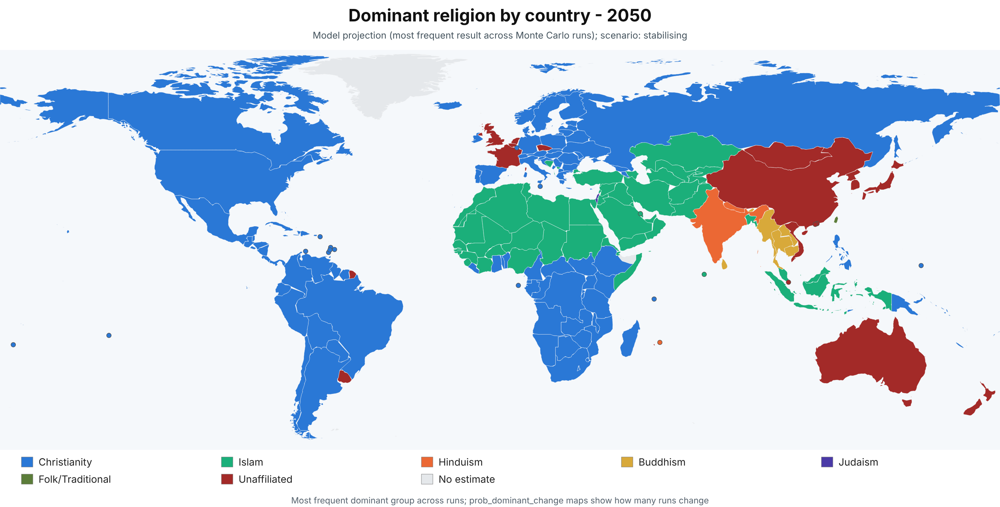

**Figure A1:** Largest religion by country, 2050, reference scenario

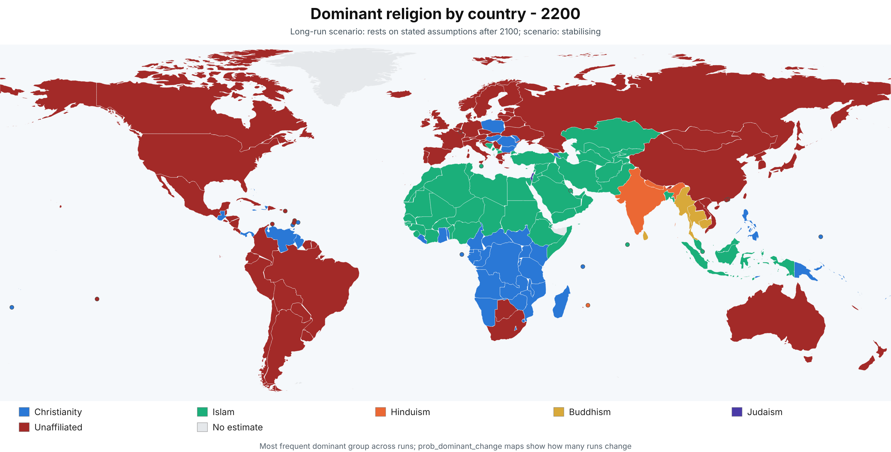

**Figure A2:** Largest religion by country, 2200 (exploratory)

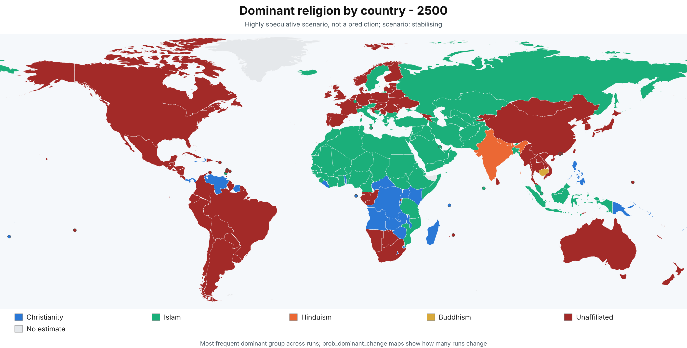

**Figure A3:** Largest religion by country, 2500 (exploratory)

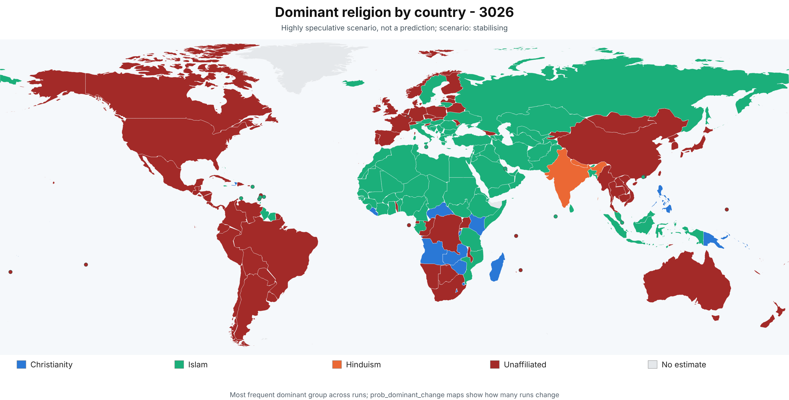

**Figure A4:** Largest religion by country, 3026 (exploratory)

## Appendix C: Sensitivity analysis

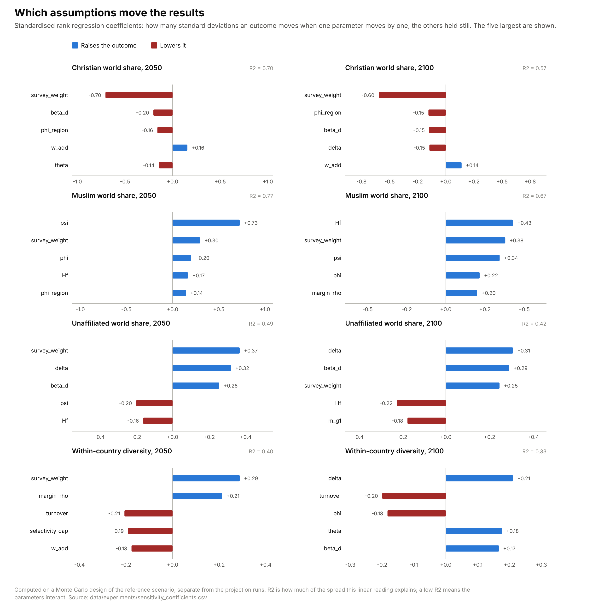

**Figure A5:** Global sensitivity analysis: standardized rank regression coefficients of the most influential parameters
